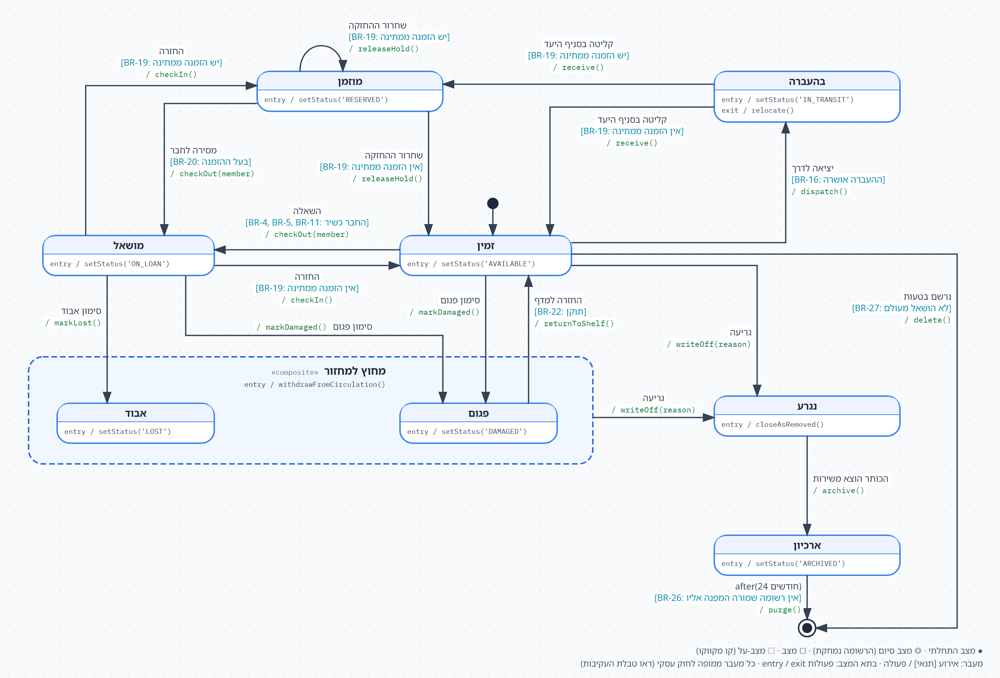
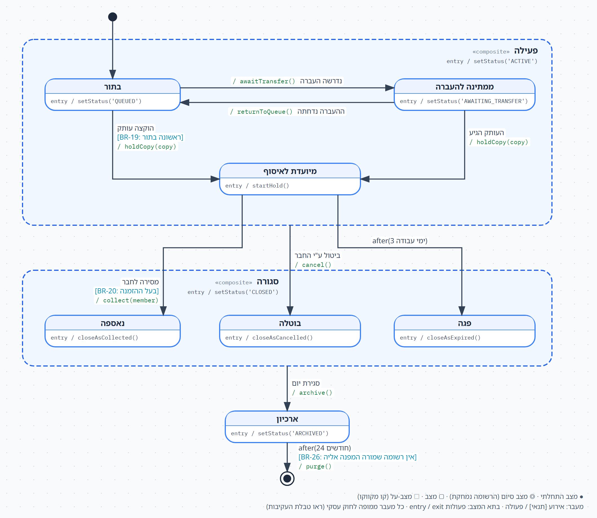

# תרשימי מצבים: הספרייה 'אשכול'

> המשך הדוגמה המלאה של הספרייה. אחרי הדרישות ותרשים ה-Use Case (הרצאות 4–5) ותרשים המחלקות
> (הרצאות 6–7), כאן תרשימי המצבים **בפורמט שנדרש בחלק ג' של הפרויקט**: שני תרשימי מצבים, טבלת עקיבות מעבר-לחוק לכל תרשים,
> המעברים שחוק עסקי אוסר, החוקים שנוספו לקטלוג והשינויים בתרשים המחלקות. התרשימים נבנו לפי
> כללי ה-`sad-mcp`; קובצי המקור (עם כפתור ייצוא ל-Visual Paradigm):
> [תרשים-מצבים-עותק-ספרייה.html](תרשים-מצבים-עותק-ספרייה.html) ·
> [תרשים-מצבים-הזמנה-ספרייה.html](תרשים-מצבים-הזמנה-ספרייה.html).

---

## אילו אובייקטים, ולמה

חיפשנו את שני האובייקטים שמחזור החיים שלהם **הכי עשיר** במקורות: הכי הרבה מצבים, והכי הרבה
אירועים שמגיעים ממקורות שונים (חבר, ספרן, ספרן רכש, מנהל סניף, השעון ואובייקט אחר).

| האובייקט | למה נבחר |
|---|---|
| **עותק (`Copy`)** | לאינומרטור `CopyStatus` יש 7 ערכים, ותשעה תרחישים משנים אותו: השאלה, החזרה, מסירת הזמנה, דיווח אבוד/פגום, שני תרחישי ההעברה, קליטת משלוח, ניהול עותקים והריצה הלילית. יש בו מעגלים אמיתיים (מושאל, חוזר, מוחזק, מושאל שוב), ענף מחיקה ישירה וקשר קומפוזיציה (`Title` ◆ `Copy`). |
| **הזמנה (`Reservation`)** | אירועים מכל הכיוונים: החבר מזמין ומבטל, הספרן מבקש העברה ומוסר, מנהל הסניף דוחה העברה, והשעון מפקיע החזקה. שלוש תוצאות עסקיות שונות (נאספה, בוטלה, פגה). |

**למה לא השאלה (`Loan`)?** ל-`LoanStatus` ארבעה ערכים, ורוב החיים שלה משתקפים כבר בעותק
(מושאל, ומשם אבוד או חזרה למדף). היא הייתה המועמדת השלישית.

**איך קוראים את התרשימים.** שמות המצבים, האירועים והתנאים בעברית; מה שבקוד נשאר באנגלית: פעולות
`entry` / `exit`, הפעולות אחרי `/` על החצים, וקבועי הסטטוס. תנאי **מפנה** לחוק ואינו מנסח אותו
מחדש: `[BR-20: בעל ההזמנה]`.

---

## תרשים 1: עותק (`Copy`)

**8 מצבים ומצב-על אחד, 19 מעברים.** כמה דברים שכדאי לשים לב אליהם:

- **מצב-העל מחוץ למחזור** מקבץ את **אבוד** ואת **פגום**, כי שניהם חולקים את אותו חץ יוצא:
  **גריעה**. חץ אחד מהגבול במקום שניים. גם הכניסה משותפת: `withdrawFromCirculation()` מוציאה את
  העותק ממניין העותקים הזמינים בקטלוג (`FR-13.3`).
- **אבוד ופגום הם שני מצבים, לא אחד**, כי הם מתנהגים אחרת: פגום שתוקן חוזר למדף (**החזרה למדף**),
  ואבוד לא. "פריט אבוד שחזר" הוא שאלה פתוחה 8, ולכן **אין** חץ כזה (ראו "מה לא צויר").
- **מוזמן שונה מזמין**: עותק מוחזק נמסר רק לבעל ההזמנה (`BR-20`), ויש לו אירוע שאין לזמין:
  **שחרור ההחזקה**. הלולאה העצמית אומרת שכשההחזקה משתחררת ויש ממתין נוסף, העותק נשאר במדף ההמתנה
  ורק ההזמנה שהוא מוחזק עבורה מתחלפת.
- **`exit / relocate()`** בבהעברה: בכל דרך שבה העותק יוצא מההעברה, הסניף שלו מתעדכן לסניף היעד
  (`FR-16.5`). פעולת יציאה אחת במקום פעולה על כל חץ יוצא.
- **שני סופים.** הסוף העסקי הוא **נגרע**, שהוא תוצאה: `closeAsRemoved()` =
  `setStatus('REMOVED'); setRemovalReason(reason)`, כך שסיבת הגריעה שורדת את הארכיון. הסוף של
  הרשומה הוא ◎.
- **קומפוזיציה:** `Title` ◆ `Copy`. כשהכותר מוצא משירות, עותקיו עוברים לארכיון (**הכותר הוצא
  משירות** `/ archive()`), בלי תנאי בצד העותק. התנאי "כל העותקים נגרעו" נמצא בצד **הכותר** (`BR-24`).
- **המעקף ל-◎:** עותק שנרשם בטעות ולא הושאל מעולם לא היה עובדה עסקית, ולכן הוא נמחק ישירות
  (**נרשם בטעות** `/ delete()`), בלי ארכיון. עותק שהושאל אפילו פעם אחת כבר מופיע בהיסטוריה, ולכן
  רק נגרע (`BR-27`).
- **תקופת השמירה:** `after(24 חודשים)`, כמו היסטוריית ההשאלות (`NFR-10`). עותק הוא נתון אב שרשומות
  אחרות מפנות אליו (השאלות, העברות, ודרכן קנסות), ולכן התנאי `[BR-26: אין רשומה שמורה המפנה אליו]`
  מאריך את חייו כל עוד רשומה שמורה מפנה אליו.

### טבלת עקיבות: מעבר ↔ חוק עסקי

| # | המעבר (ממצב ← למצב) | האירוע | החוק העסקי |
|---|---|---|---|
| C0 | ● ← זמין | (החץ ההתחלתי: עותק נוסף או נקלט ממשלוח) | (אין: החריג היחיד) |
| C1 | זמין ← מושאל | השאלה `/ checkOut(member)` | `BR-4` · `BR-5` · `BR-11` |
| C2 | מושאל ← זמין | החזרה `/ checkIn()` (כולל החזרה אוטומטית של פריט דיגיטלי) | `BR-19` · `BR-14` |
| C3 | מושאל ← מוזמן | החזרה `/ checkIn()` | `BR-19` |
| C4 | מוזמן ← מושאל | מסירה לחבר `/ checkOut(member)` | `BR-20` (וכללי ההשאלה `BR-4` · `BR-5` · `BR-11`) |
| C5 | מוזמן ← מוזמן | שחרור ההחזקה `/ releaseHold()` (ההזמנה פגה או בוטלה, ויש ממתין נוסף) | `BR-8` · `BR-21` · `BR-19` |
| C6 | מוזמן ← זמין | שחרור ההחזקה `/ releaseHold()` (אין ממתין) | `BR-8` · `BR-21` · `BR-19` |
| C7 | זמין ← בהעברה | יציאה לדרך `/ dispatch()` | `BR-16` |
| C8 | בהעברה ← מוזמן | קליטה בסניף היעד `/ receive()` | `BR-19` · `BR-8` |
| C9 | בהעברה ← זמין | קליטה בסניף היעד `/ receive()` | `BR-19` |
| C10 | מושאל ← אבוד | סימון אבוד `/ markLost()` (הריצה הלילית אחרי 30 יום, או דיווח ספרן) | `BR-9` |
| C11 | מושאל ← פגום | סימון פגום `/ markDamaged()` (בקליטת ההחזרה) | `BR-22` |
| C12 | זמין ← פגום | סימון פגום `/ markDamaged()` | `BR-22` |
| C13 | פגום ← זמין | החזרה למדף `/ returnToShelf()` | `BR-22` |
| C14 | מחוץ למחזור ← נגרע | גריעה `/ writeOff(reason)` | `BR-23` |
| C15 | זמין ← נגרע | גריעה `/ writeOff(reason)` | `BR-23` |
| C16 | נגרע ← ארכיון | הכותר הוצא משירות `/ archive()` | `BR-24` |
| C17 | ארכיון ← ◎ | `after(24 חודשים)` `/ purge()` | `BR-26` |
| C18 | זמין ← ◎ | נרשם בטעות `/ delete()` | `BR-27` |

### מעברים שחוק עסקי אוסר

- **אין גריעה של עותק מושאל, מוזמן או בהעברה** (`BR-23`): אין חץ גריעה ממושאל, ממוזמן או מבהעברה.
  קודם מחזירים, משחררים או קולטים.
- **אין מחיקה של עותק שהושאל אי-פעם** (`BR-27`): המעקף ל-◎ יוצא רק מזמין, ורק בתנאי.
- **אין מסירה של עותק מוחזק למי שאינו בעל ההזמנה** (`BR-20`): התנאי נכשל ולא קורה כלום.
- **אין השאלה לחבר שאינו כשיר** (`BR-4`, `BR-5`, `BR-11`): התנאי על ההשאלה נכשל.
- **עותק פגום אינו חוזר ישר להשאלה** (`BR-22`): מפגום חוזרים רק לזמין, ורק אחרי תיקון.
- **אין חזרה מנגרע למחזור**: גריעה היא סופית לפי `BR-23`; לכן לנגרע אין אירוע מלבד הוצאת הכותר
  משירות.

---

## תרשים 2: הזמנה (`Reservation`)

**7 מצבים ושני מצבי-על, 10 מעברים.**

- **מצב-העל פעילה** מקבץ את שלושת המצבים שבהם ההזמנה עדיין חיה. החץ **ביטול ע"י החבר** יוצא
  **מהגבול**, ולכן החבר יכול לבטל מכל אחד מהם (`BR-21`). בלי מצב-העל היו שלושה חצים זהים.
- **מצב-העל סגורה** מקבץ את שלוש התוצאות, שחולקות את אותו חץ יוצא לארכיון (**סגירת יום**). זה
  "מתכנסים, לא מתפצלים": חץ אחד לארכיון, וחץ אחד ממנו ל-◎.
- **ממתינה להעברה הוא מצב חדש**, שאינו במילון: ההזמנה ממתינה לעותק שבדרך מסניף אחר. הוא מצב אמיתי
  כי הוא מקבל אירוע שאין לבתור (**ההעברה נדחתה**, שמחזיר את ההזמנה **אחורה** לתור).
- **שלוש התוצאות שומרות את הסיבה.** כל אחת נכנסת דרך פעולה עוטפת אחת:
  - `closeAsCollected()` = `setStatus('COLLECTED'); setClosureReason('COLLECTED')`
  - `closeAsCancelled()` = `setStatus('CANCELLED'); setClosureReason('CANCELLED'); releaseHeldCopy()`
  - `closeAsExpired()` = `setStatus('EXPIRED'); setClosureReason('EXPIRED'); releaseHeldCopy()`

  `releaseHeldCopy()` שולחת לעותק המוחזק (אם יש) את האירוע **שחרור ההחזקה**: זה החץ C5 או C6
  בתרשים העותק. כך שני התרשימים מדברים זה עם זה.
- `startHold()` = `setStatus('READY_FOR_PICKUP'); setHoldExpiry(); notifyMember()` (`BR-8`,
  `FR-3.4`).
- **אין מעקף ל-◎.** כל דרך שבה הזמנה מסתיימת היא עובדה שמדווחים עליה: גם הזמנה שבוטלה או שפגה
  נכנסת לדוחות, והיסטוריית הפקיעות היא בדיוק מה ששאלה פתוחה 1 (no-show חוזר) תצטרך כשתוכרע.
  הזמנה שאין להתחיל אותה (`FR-3.6`) פשוט אינה נוצרת.
- **תקופת השמירה:** `after(24 חודשים)`. הזמנה היא רשומה תפעולית בלי כסף, והיא חושפת הרגלי קריאה,
  כמו היסטוריית ההשאלות (`NFR-10`).

### טבלת עקיבות: מעבר ↔ חוק עסקי

| # | המעבר (ממצב ← למצב) | האירוע | החוק העסקי |
|---|---|---|---|
| R0 | ● ← בתור | (החץ ההתחלתי: החבר הזמין, UC-2) | (אין: החריג היחיד) |
| R1 | בתור ← מיועדת לאיסוף | הוקצה עותק `/ holdCopy(copy)` | `BR-19` · `BR-8` |
| R2 | בתור ← ממתינה להעברה | נדרשה העברה `/ awaitTransfer()` | `BR-16` |
| R3 | ממתינה להעברה ← בתור | ההעברה נדחתה `/ returnToQueue()` | `BR-16` |
| R4 | ממתינה להעברה ← מיועדת לאיסוף | העותק הגיע `/ holdCopy(copy)` (נקלט בסניף האיסוף) | `BR-8` |
| R5 | מיועדת לאיסוף ← נאספה | מסירה לחבר `/ collect(member)` | `BR-20` (וכללי ההשאלה `BR-4` · `BR-5` · `BR-11`) |
| R6 | מיועדת לאיסוף ← פגה | `after(3 ימי עבודה)` | `BR-8` |
| R7 | פעילה ← בוטלה | ביטול ע"י החבר `/ cancel()` | `BR-21` |
| R8 | סגורה ← ארכיון | סגירת יום `/ archive()` | `BR-25` |
| R9 | ארכיון ← ◎ | `after(24 חודשים)` `/ purge()` | `BR-26` |

### מעברים שחוק עסקי אוסר

- **אין ביטול אחרי איסוף** (`BR-21`): הביטול יוצא מגבול פעילה, לא מנאספה.
- **אין הארכת החזקה**: אין לולאה עצמית על מיועדת לאיסוף; אחרי 3 ימי עבודה ההזמנה פגה (`BR-8`).
- **אין מסירה למי שאינו בעל ההזמנה** (`BR-20`): התנאי על המסירה נכשל.
- **הזמנה שנסגרה אינה חוזרת לתור** (`BR-25`): מסגורה יוצא רק החץ לארכיון. חבר שרוצה שוב מזמין
  הזמנה חדשה.
- **הזמנה שאינה עומדת בתנאים אינה נוצרת** (`BR-4`, `BR-7`, `BR-11`, `BR-12`): אלה תנאים על
  **יצירת** האובייקט, והם נבדקים בתרחיש לפני שההזמנה קיימת. לכן הם לא על החץ ההתחלתי, שאינו
  נושא תווית.

### מה לא צויר, ולמה

חץ שלא צויר אומר "אסור". לכן מעבר שהארגון **טרם הכריע** בו אינו מצויר, והוא מחכה בשאלות הפתוחות:

- **פריט "אבוד" שחזר** (שאלה פתוחה 8): אין חץ מאבוד לזמין.
- **עותק שאבד אחרי ששובץ להזמנה** (שאלה פתוחה 4): אין חץ ממיועדת לאיסוף או מממתינה להעברה חזרה
  לתור.
- **no-show חוזר** (שאלה פתוחה 1): אין סנקציה על החבר בפגה.

---

## חוקים עסקיים שנוספו לקטלוג (סעיף 3.3)

כל החוקים הוכרעו בידי **מנהל הרשת (אבי כהן)**, הבעלים של הכללים הרוחביים, בפגישת התכנון של
תרשימי המצבים. כל אחד מהם נשען על דרישה או תרחיש שכבר היו במסמך, ורק נתן להם ניסוח של חוק.

| מזהה | החוק העסקי | נשען על | בעלים | מועד הכרעה |
|---|---|---|---|---|
| `BR-19` | עותק שהוחזר, שנקלט מהעברה או שהחזקתו שוחררה מוקצה להזמנה הוותיקה ביותר לאותו כותר שסניף האיסוף שלה הוא סניף העותק; רק כשאין הזמנה כזו הוא חוזר למדף. | `FR-3.1` · `FR-9.3` · `FR-23.6` · `BR-8` | מנהל הרשת | 2026-10-01 |
| `BR-20` | פריט מוזמן נמסר רק לחבר שההזמנה על שמו, ובכפוף לכללי ההשאלה. | `FR-12.4` · `FR-12.5` | מנהל הרשת | 2026-10-01 |
| `BR-21` | חבר רשאי לבטל הזמנה שלו כל עוד לא נאספה; העותק המוחזק עבורו, אם יש, עובר הלאה לפי `BR-19`. | `FR-3.5` · UC-2 | מנהל הרשת | 2026-10-01 |
| `BR-22` | עותק שנמצא פגום, בהחזרה או במדף, יוצא ממחזור ההשאלות עד שספרן מאשר שתוקן, ואז חוזר למדף; עותק שאינו ניתן לתיקון נגרע. | `FR-9.4` · `FR-13.2` | מנהל הרשת | 2026-10-01 |
| `BR-23` | גריעת עותק נעשית בידי ספרן הרכש עם סיבת גריעה, ורק לעותק שעל המדף, אבוד או פגום. עותק מושאל, מוחזק להזמנה או בהעברה אינו נגרע. הגריעה סופית. | `FR-26.3.2` · UC-22 | מנהל הרשת | 2026-10-01 |
| `BR-24` | כותר מוצא משירות רק כשכל עותקיו נגרעו, ועם הוצאתו עותקיו עוברים לארכיון. | `FR-15.3.2` | מנהל הרשת | 2026-10-01 |
| `BR-25` | הזמנה שנסגרה (נאספה, בוטלה או פגה) יוצאת מהתור ומהמסכים התפעוליים בסגירת היום (הריצה הלילית) שאחרי סגירתה, ונשמרת בארכיון לדוחות. | `FR-23` | מנהל הרשת | 2026-10-01 |
| `BR-26` | רשומת הזמנה או עותק בארכיון נשמרת 24 חודשים, ונמחקת רק כשאין רשומה שמורה אחרת המפנה אליה. | `NFR-10` | מנהל הרשת | 2026-10-01 |
| `BR-27` | עותק שנרשם בטעות ולא הושאל מעולם נמחק לצמיתות; עותק שהושאל אי-פעם נגרע ואינו נמחק. | `FR-26.4.1` · UC-22 | מנהל הרשת | 2026-10-01 |

---

## השינויים בתרשים המחלקות

בתרשים המחלקות של חלק ב' אין עדיין פעולות כלל, ולכן **כל** שיטה שמופיעה בתרשימי המצבים נוספת
עכשיו. גם המצבים החדשים נכנסים לאינומרטורים.

| המחלקה | מה נוסף |
|---|---|
| `Copy` | **תכונה:** `removalReason : String` (סיבת הגריעה, שתרחיש ניהול העותקים כבר אוסף). **פעולות:** `setStatus(status : CopyStatus)`, `checkOut(member : Member)`, `checkIn()`, `releaseHold()`, `dispatch()`, `receive()`, `relocate()`, `markLost()`, `markDamaged()`, `returnToShelf()`, `withdrawFromCirculation()`, `writeOff(reason : String)`, `closeAsRemoved()`, `archive()`, `delete()`, `purge()` |
| `CopyStatus` | **ערכים חדשים:** `OutOfCirculation`, `Archived` (שבעת הערכים הקיימים נשארים) |
| `Reservation` | **תכונה:** `closureReason : ReservationStatus`. **פעולות:** `setStatus(status : ReservationStatus)`, `holdCopy(copy : Copy)`, `startHold()`, `awaitTransfer()`, `returnToQueue()`, `collect(member : Member)`, `cancel()`, `closeAsCollected()`, `closeAsCancelled()`, `closeAsExpired()`, `archive()`, `purge()` |
| `ReservationStatus` | **ערכים חדשים:** `AwaitingTransfer`, `Active`, `Closed`, `Archived` |
| `Title` | **פעולה:** `withdraw()`, שקוראת ל-`archive()` של כל עותק (`BR-24`) |

**מהמצב לערך באינומרטור.** כל מצב בתרשים הוא ערך של אינומרטור הסטטוס, וכותב אותו בכניסה
(`setStatus`, או השורה הראשונה של הפעולה העוטפת):

| עותק | `CopyStatus` | הזמנה | `ReservationStatus` |
|---|---|---|---|
| זמין | `Available` (`'AVAILABLE'`) | פעילה (מצב-על) | `Active` (`'ACTIVE'`) |
| מושאל | `OnLoan` (`'ON_LOAN'`) | בתור | `Queued` (`'QUEUED'`) |
| מוזמן | `Reserved` (`'RESERVED'`) | ממתינה להעברה | `AwaitingTransfer` (`'AWAITING_TRANSFER'`) |
| בהעברה | `InTransit` (`'IN_TRANSIT'`) | מיועדת לאיסוף | `ReadyForPickup` (`'READY_FOR_PICKUP'`) |
| מחוץ למחזור (מצב-על) | `OutOfCirculation` (`'OUT_OF_CIRCULATION'`) | סגורה (מצב-על) | `Closed` (`'CLOSED'`) |
| אבוד | `Lost` (`'LOST'`) | נאספה | `Collected` (`'COLLECTED'`) |
| פגום | `Damaged` (`'DAMAGED'`) | בוטלה | `Cancelled` (`'CANCELLED'`) |
| נגרע | `Removed` (`'REMOVED'`) | פגה | `Expired` (`'EXPIRED'`) |
| ארכיון | `Archived` (`'ARCHIVED'`) | ארכיון | `Archived` (`'ARCHIVED'`) |

גם למצבי-העל יש ערך, כי כל מצב, כולל מצב-על, רושם את הסטטוס שלו בכניסה.
